# Detecting Nmap SYN Scans with Wireshark (Firewall OFF vs ON)

A hands-on SOC / blue-team lab. I scan a Windows 10 machine from Kali Linux with Nmap, capture the traffic on the Windows (victim) side with Wireshark, and document what the scan looks like to a defender: first with the Windows firewall off, then with it on.

**Author:** Muhammad SamiUllah Khan ([LinkedIn](https://www.linkedin.com/in/muhammad-sami-ullah-khan-4453b8351/)) | **Lab date:** 9 October 2026

> Everything ran on my own virtual machines on an isolated VMware NAT network. No outside system was scanned.

---

## Key results

| | Firewall OFF | Firewall ON |
|---|---|---|
| Ping from Kali | 10/10 replies | 100% packet loss |
| Nmap result | 3 open (135, 139, 445), 997 closed | 1,000 filtered, 0 open |
| Replies from the target | 1,000 (997 RST,ACK + 3 SYN-ACK) | 0 |
| SYN probes captured | 1,080 | 2,000 |
| TCP conversations in Wireshark | 1,080 | 2,000 |
| Nmap scan time | 6.50 s | 27.73 s |

**What this shows:** the firewall hid every service (0 open ports, 0 replies), but the scan became slower and noisier on the wire. Nmap got no answers, so it re-sent every probe. Even with ping blocked, Nmap still found the host through ARP, because a host firewall cannot hide a machine from its own subnet.

### Where each number comes from

| Number | Proof |
|---|---|
| Ping 10/10 replies (firewall off) | `05-kali-ping.png` |
| 3 open, 997 closed, 6.50 s (firewall off) | `10-nmap-output.png` |
| 1,080 SYN probes (firewall off) | `11-nmap-syn-probes.png`, "Displayed" in the status bar |
| 997 RST,ACK replies | `12-nmap-rst-replies.png`, "Displayed" in the status bar |
| 3 SYN-ACK replies | `13-nmap-synack-open.png`, "Displayed" in the status bar |
| 1,080 TCP conversations (firewall off) | `14-nmap-tcp-conversations.png`, tab title "TCP · 1080" |
| Firewall ON for all profiles | `15-firewall-on.png` |
| Ping 100% loss (firewall on) | `16-ping-fw-on.png` |
| 1,000 filtered, 27.73 s (firewall on) | `17-nmap-output-fw-on.png` |
| 2,000 SYN probes (firewall on) | `18-fw-on-syn-probes.png`, "Displayed" in the status bar |
| 0 replies from the target (firewall on) | `19-fw-on-replies.png`, "Displayed: 0" |
| 2,000 TCP conversations (firewall on) | `20-fw-on-tcp-conversations.png`, tab title "TCP · 2000" |

---

## Lab setup

| Role | OS | IP | Resources |
|---|---|---|---|
| Attacker | Kali Linux 2026.2 | 192.168.170.139 | 2 GB RAM, 80 GB disk |
| Target (victim) | Windows 10 (build 19045) | 192.168.170.144 | 2.5 GB RAM, 40 GB disk |

- Hypervisor: VMware Workstation, both VMs on a NAT network
- Capture point: Wireshark on the Windows target, so I see what the victim sees
- Scanner: Nmap 7.99

| Evidence | Screenshot |
|---|---|
| Windows firewall OFF (before) | 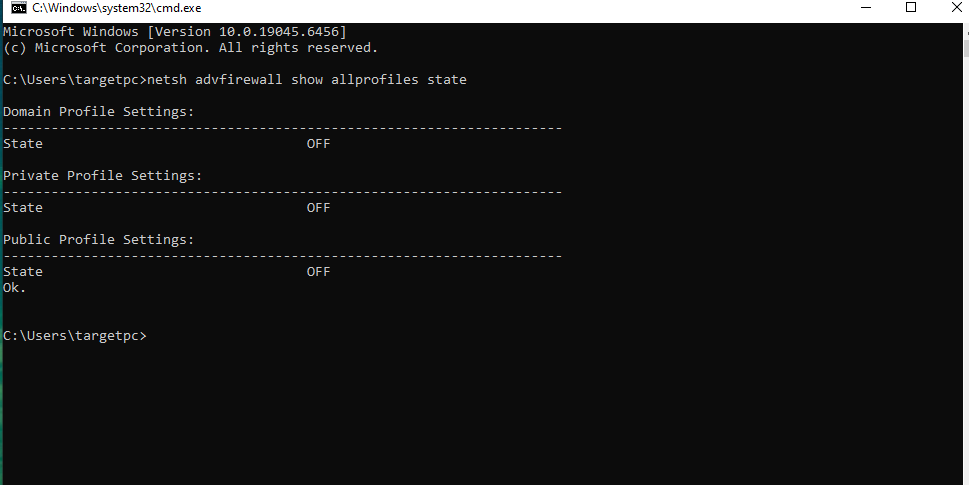 |
| Windows IP configuration | 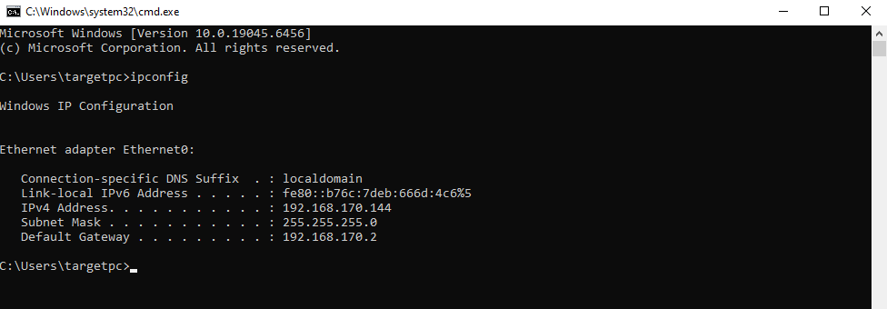 |
| Kali IP configuration | 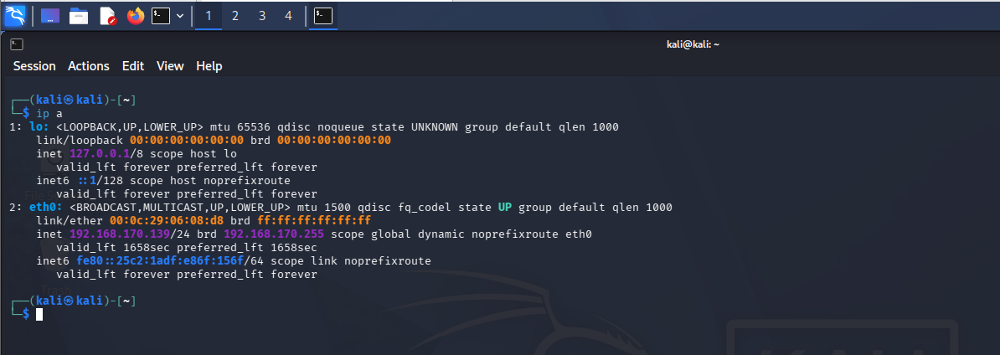 |
| Kali VM network = NAT | 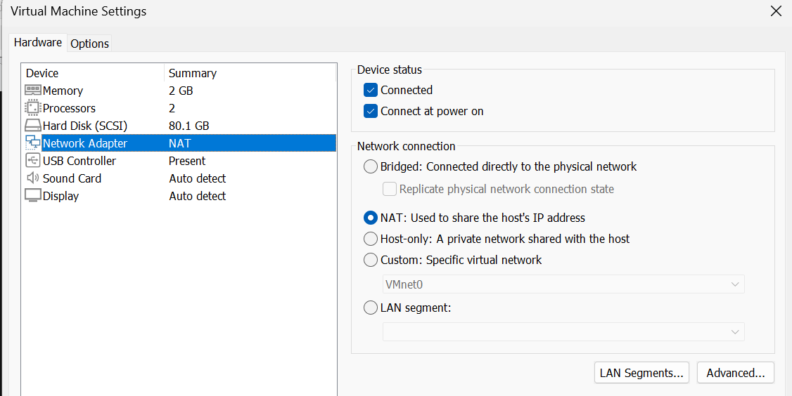 |
| Windows VM network = NAT | 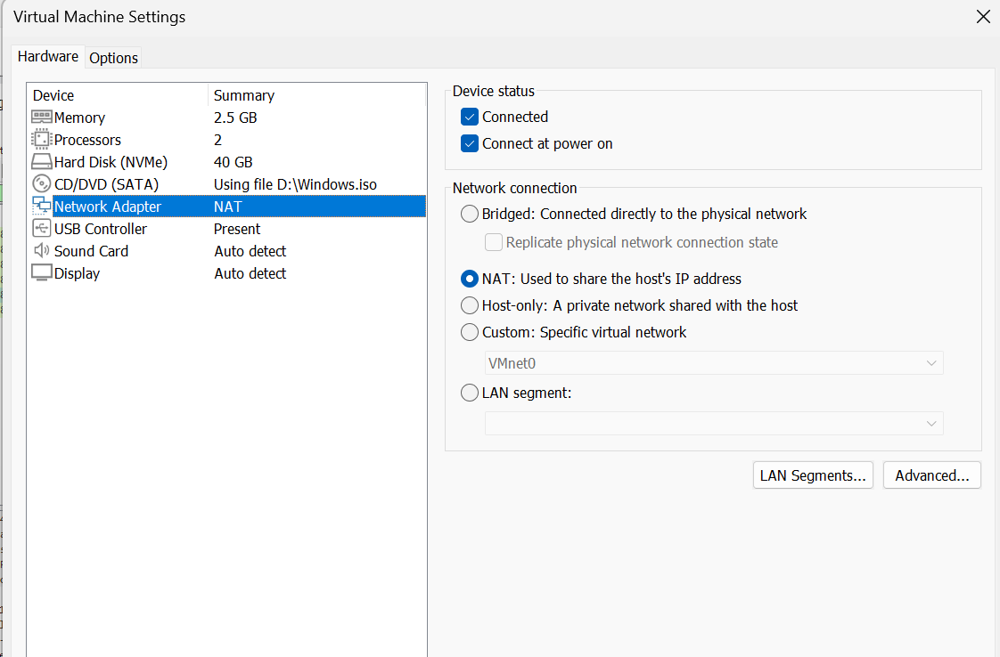 |

---

## 1. Baseline: what normal traffic looks like

Capture: [`pcaps/baseline.pcapng`](pcaps/baseline.pcapng) (375 packets)

- **ARP is 71.7% of the packets.** Windows keeps asking "Who has 192.168.170.2?" and nobody answers, because the VMware NAT gateway does not reply. This is a lab artifact, and it is why filtering matters.
- **Ping reveals the OS.** Kali's echo requests have TTL 64 and Windows' replies have TTL 128.
- **HTTP.** Windows browsed a Python web server on Kali. The `User-Agent` header exposes the client as Windows NT 10.0 with Edge.
- Background protocols also appear: LLMNR, mDNS, NetBIOS, DHCP and IGMP.
- The capture also contains 3 ICMP "port unreachable" packets from Kali to Windows. They answer UDP traffic that Windows sent to a closed port on Kali. I left them in so the capture is unedited.

| | |
|---|---|
| Ping, 10 packets, 0% loss | 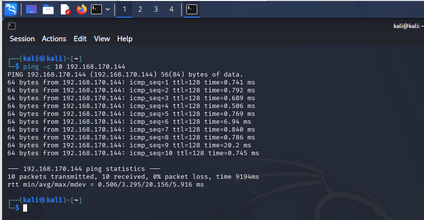 |
| Protocol hierarchy | 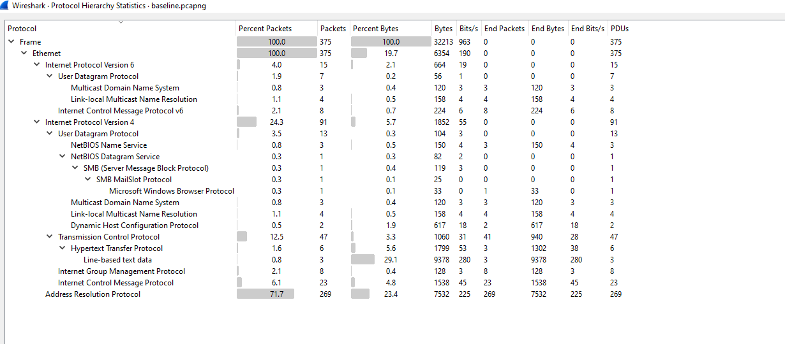 |
| IPv4 conversations | 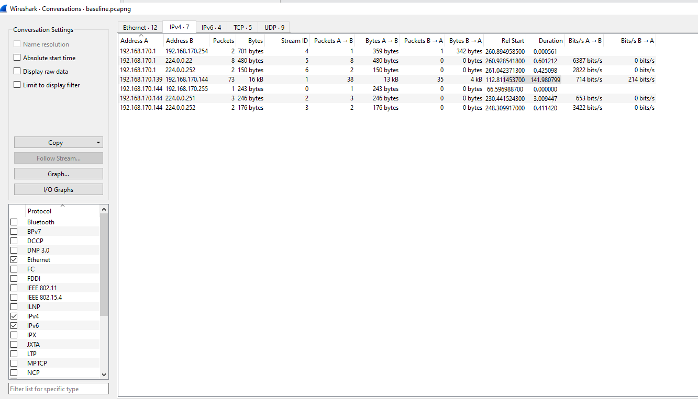 |
| ICMP echo request/reply | 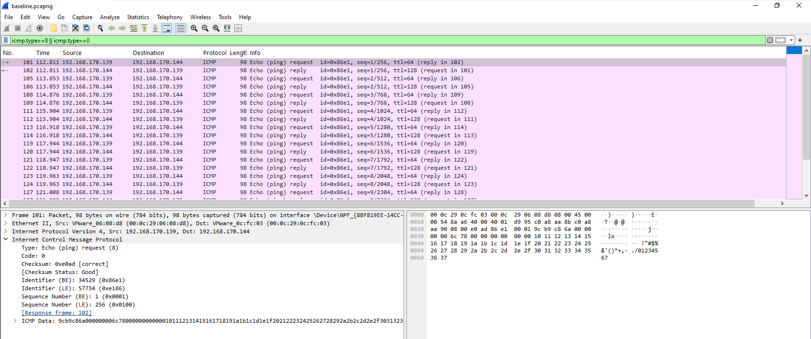 |
| HTTP request | 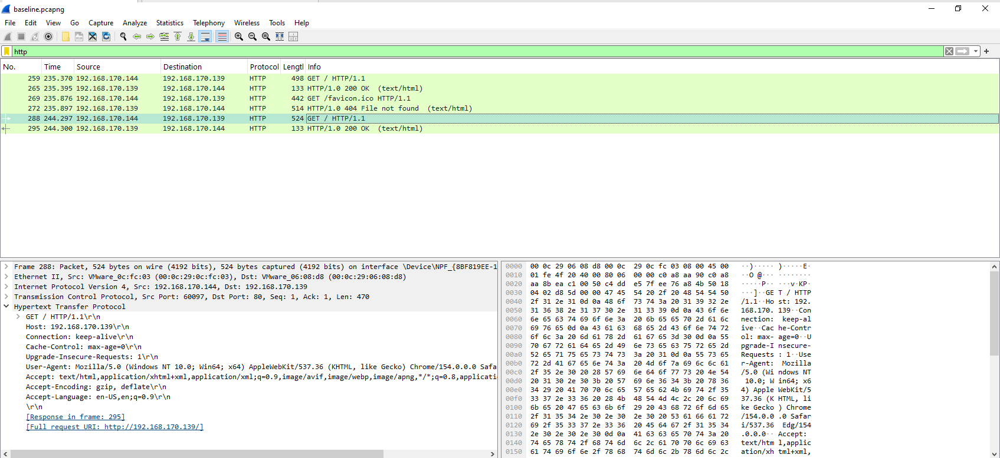 |

---

## 2. Scenario: Nmap SYN scan, firewall OFF

Capture: [`pcaps/nmap-syn-fw-off.pcapng`](pcaps/nmap-syn-fw-off.pcapng) | Nmap output: [`reports/nmap-syn-fw-off.txt`](reports/nmap-syn-fw-off.txt)

```
sudo nmap -sS -p 1-1000 -T4 -oN nmap-syn-fw-off.txt 192.168.170.144
```

**Result:** 135/tcp (msrpc), 139/tcp (netbios-ssn) and 445/tcp (microsoft-ds) open; 997 closed ports (reset); scan completed in 6.50 seconds.

**How it looks in Wireshark**

- **One source, 1,080 SYN probes.** All come from 192.168.170.139, nearly all from source port 54870. About 80 are retransmissions sent from a second source port.
- **Random port order.** Destination ports are hit non-sequentially (53, 22, 23, 199, 21, 554, ...).
- **Tiny, identical packets.** Every probe is 60 bytes with `Window=1024` and only the MSS option, which is consistent with Nmap's default raw SYN scan.
- **Closed ports answer RST,ACK** (997 packets).
- **Open ports answer SYN,ACK** (3 packets, from ports 135, 139 and 445).

| | |
|---|---|
| Nmap output on Kali | 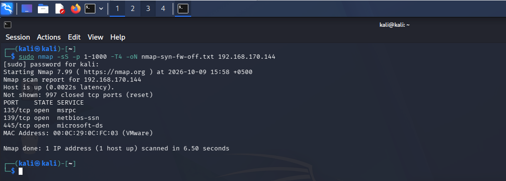 |
| SYN probes (1,080 displayed) | 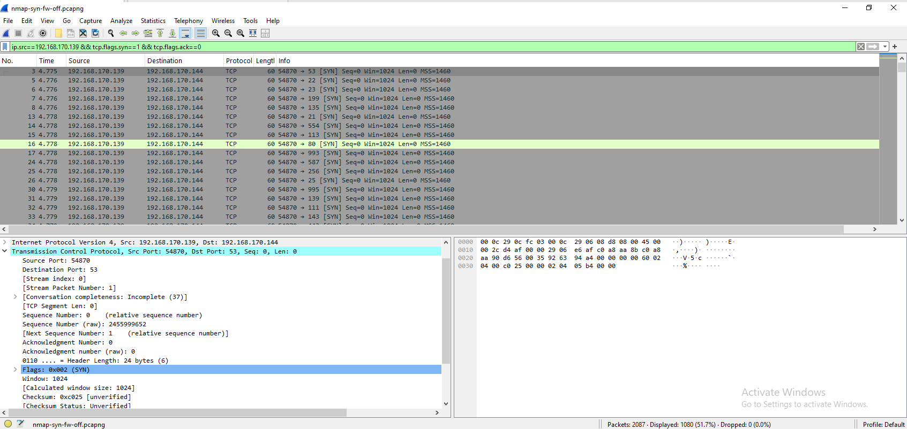 |
| RST replies (997 displayed) | 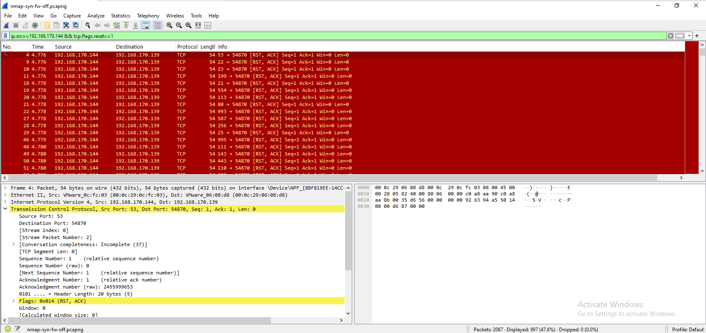 |
| SYN-ACK replies (3 displayed) | 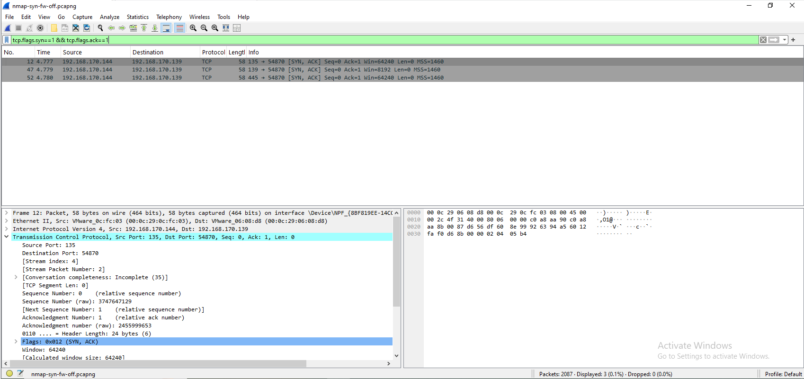 |
| TCP conversations (1,080) | 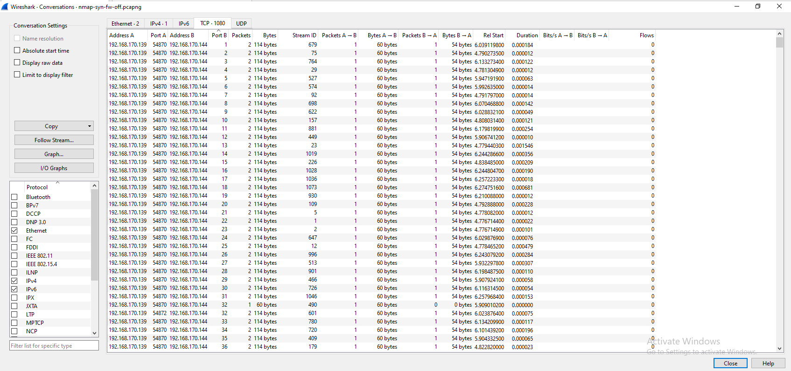 |

**MITRE ATT&CK:** T1046 Network Service Discovery

---

## 3. Scenario: the same scan, firewall ON

Windows Firewall switched on for all profiles (`netsh advfirewall set allprofiles state on`).

Capture: [`pcaps/nmap-syn-fw-on.pcapng`](pcaps/nmap-syn-fw-on.pcapng) | Nmap output: [`reports/nmap-syn-fw-on.txt`](reports/nmap-syn-fw-on.txt)

```
sudo nmap -sS -p 1-1000 -T4 -oN nmap-syn-fw-on.txt 192.168.170.144
```

**Result:** all 1,000 ports reported as filtered (no response); scan took 27.73 seconds.

**How it looks in Wireshark**

- **Zero replies.** Filtering for TCP traffic from the target shows no packets at all.
- **Every port probed twice.** Nmap received no answers, so it retried each port from a second source port (38863 and 38865). That gives 2,000 TCP conversations of one packet each.
- **The host was still discovered.** Ping was blocked, yet Nmap reported "Host is up" and printed the MAC address, because ARP on the local subnet cannot be firewalled.

| | |
|---|---|
| Firewall ON (all profiles) | 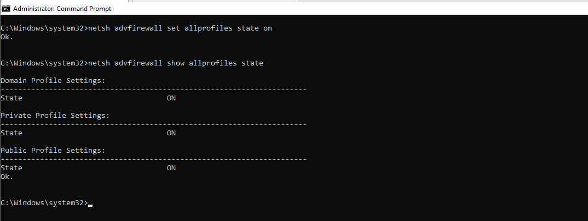 |
| Ping blocked, 100% loss | 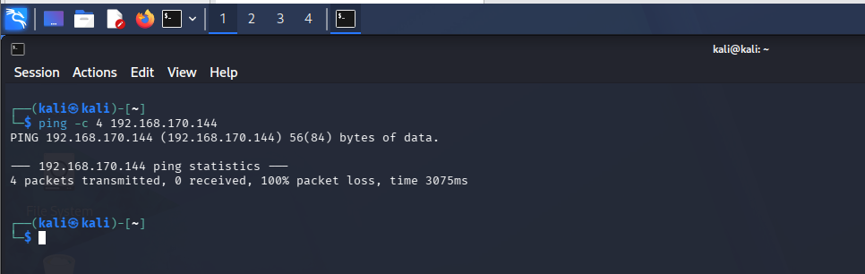 |
| Nmap output, all filtered | 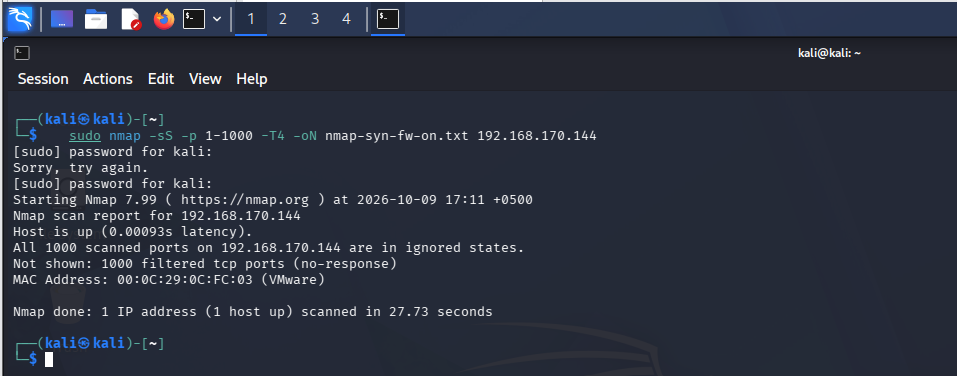 |
| SYN probes | 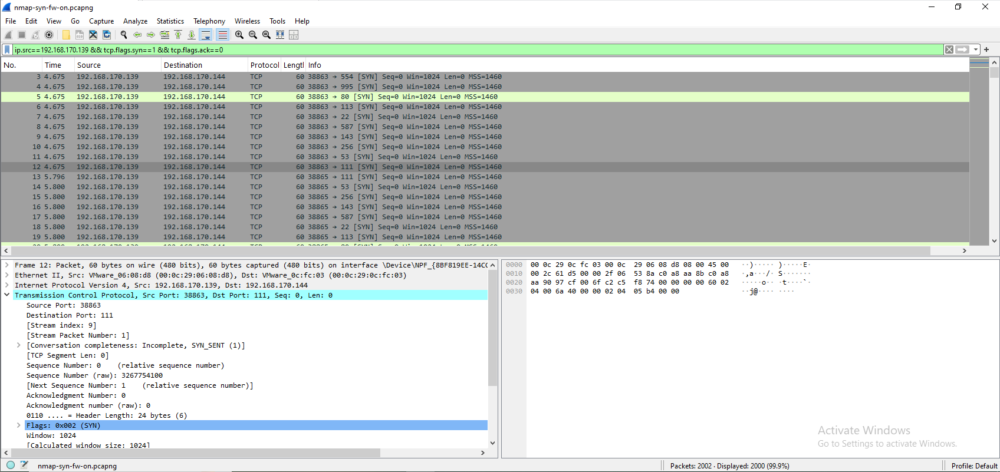 |
| No replies from the target | 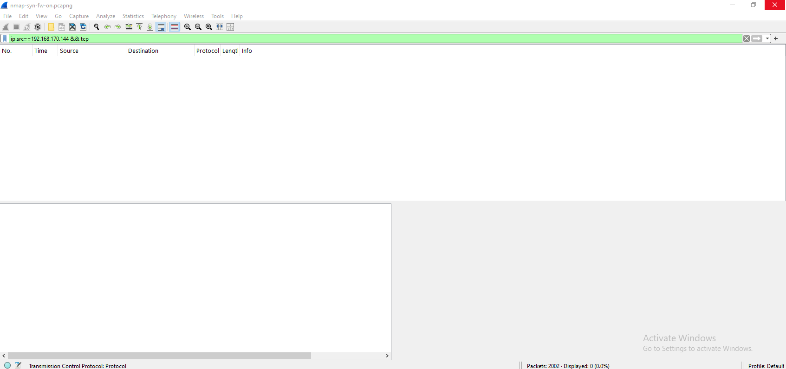 |
| TCP conversations (2,000) | 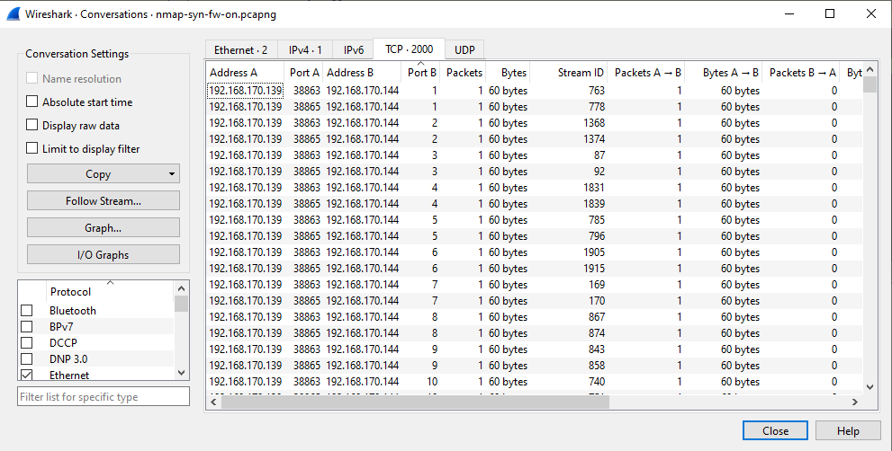 |

---

## Detection cheat sheet

| What I was looking for | Wireshark filter |
|---|---|
| SYN probes from the scanner | `ip.src==192.168.170.139 && tcp.flags.syn==1 && tcp.flags.ack==0` |
| Closed-port replies | `ip.src==192.168.170.144 && tcp.flags.reset==1` |
| Open-port replies | `tcp.flags.syn==1 && tcp.flags.ack==1` |
| Target silent (firewall on) | `ip.src==192.168.170.144 && tcp` |
| Ping | `icmp.type==8 \|\| icmp.type==0` |
| Web traffic | `http` |

Also useful: **Statistics > Conversations > TCP** (one source touching hundreds of ports) and **Statistics > Protocol Hierarchy**.

---

## SOC-style incident note

- **Alert:** port scan from 192.168.170.139 against 192.168.170.144
- **Evidence:** 1,080 SYN probes to 1,000 distinct ports in a few seconds from a single source; identical 60-byte packets; random port order; 997 RST,ACK replies and 3 SYN-ACK replies from the target.
- **Finding:** services 135, 139 and 445 are exposed when the firewall is off.
- **Technique:** MITRE ATT&CK T1046, Network Service Discovery.
- **Recommended response:** keep the host firewall on with default-deny inbound, block or isolate the scanning source, close or restrict ports 135/139/445 unless needed, and add a network IDS or SIEM rule that alerts when one source sends SYNs to many ports in a short window.

---

## What I learned

- Reading a SYN scan from the victim's side: probes, RST,ACK for closed ports, SYN-ACK for open ports.
- A baseline matters. Without it, ARP noise and normal broadcasts would hide the attack.
- A host firewall removes exposed services and makes the scan slower, but it does not hide the machine from its own subnet and it makes the scanner louder on the wire.
- Capturing with a clear method (start capture, run the scan, stop, save, filter) makes results reproducible.

## Limitations and planned next steps

- One scan type (TCP SYN, ports 1-1000), one target, no IDS or SIEM, and Windows firewall logging was not enabled.
- Planned: brute-force detection (Hydra) and a cleartext-credentials capture in the same lab.
- Planned later: forwarding logs to a SIEM (Wazuh) and correlating firewall logs with the packet captures.

---

## Repository contents

```
README.md
pcaps/          baseline.pcapng, nmap-syn-fw-off.pcapng, nmap-syn-fw-on.pcapng
reports/        nmap-syn-fw-off.txt, nmap-syn-fw-on.txt
screenshots/    numbered evidence (00-20)
```
